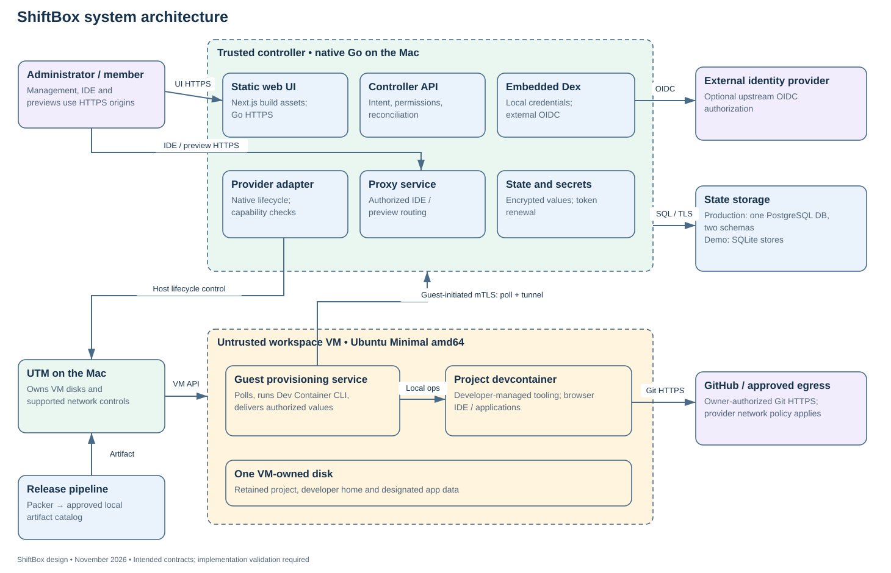
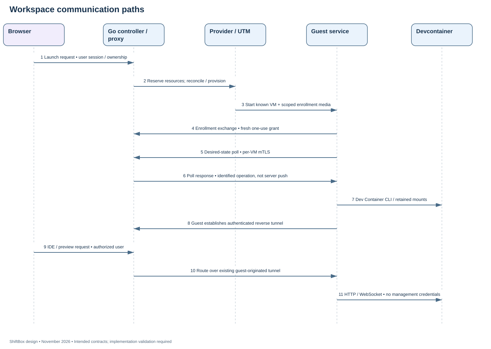
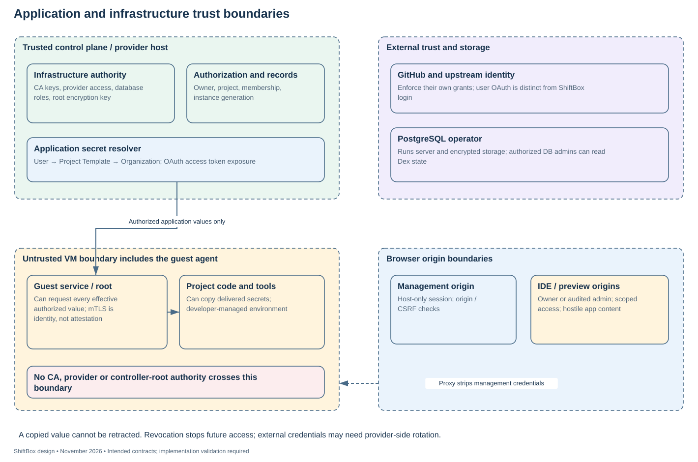

# Architecture and communication

**Status:** Design synthesis for user review. Sources of authority: accepted decisions Q1–Q155 and the subsequent explicit Mantine selection; [readback](design-readback.md). Diagrams describe intended behavior, not a deployed system.

## Guiding architecture

ShiftBox separates **workspace intent**, **provider infrastructure** and **guest execution**. The controller owns identities, policy, desired state and recovery. A provider adapter translates machine operations into its native platform. A guest service reconciles project-container operations inside its own VM. This structure permits a later EC2 implementation without requiring users to adopt Kubernetes or expose the VM lifecycle as Kubernetes resources.

The original orchestrator-agnostic aspiration is a portability direction, not a phase-one promise of arbitrary scheduler plugins. Native Mac/UTM is the first supported topology. Linux/container-hosted controllers arrive with EC2. A single binary is a delivery goal, not a guarantee of one process or zero dependencies.

Ona's account identifies operational mismatch between stateful developer workloads and its Kubernetes substrate, while retaining control loops and declarative APIs in the replacement. That supports evaluating a different execution substrate; it does not prove that ShiftBox will scale, that Kubernetes is universally unsuitable, or that UTM fulfills this contract. [Ona: We're leaving Kubernetes](https://ona.com/stories/we-are-leaving-kubernetes)

## Components and ownership

| Component | Owns | Does not own |
| --- | --- | --- |
| Go HTTPS/UI service | Static React/Next.js assets using Mantine components, APIs, browser authentication integration | A Next.js runtime or developer application code |
| Controller | Workspace intent, ownership, policy, operation journal, reconciliation, capacity, identity authorization | Provider disk/network implementation |
| Provider adapter | Native lifecycle, authoritative inventory, capability reporting, enrollment delivery | User-defined shell execution or unproven network restrictions |
| Guest provisioning service | Dev Container CLI, approved lifecycle operations, activity reports, secret delivery and outbound tunnel | Infrastructure credentials or organization-wide API authority |
| Proxy | Authorized IDE/preview routing, connection revocation, guest tunnel endpoints | Arbitrary workspace outbound Internet traffic |
| Embedded Dex | OIDC credentials, authentication and upstream connectors | ShiftBox membership/permissions |
| Application state service | PostgreSQL/SQLite transactions, encrypted application values, durable reconciliation | External PostgreSQL server administration |
| Release/image pipeline | Packer platform artifacts, signed guest releases, validation manifests | Per-workspace image building at VM launch |

Internal modules may share a Go process while retaining these contracts. A helper process for safe guest upgrades or compatible PostgreSQL client utilities does not change the public product boundary. Provider adapters are compiled in; public runtime plugins and remote provisioning workers are deferred.

## UI component architecture

**Mantine is the selected component library** for the React/Next.js/TypeScript application. Use its components and shared theme consistently across setup, workspace management and administration. Integrate `MantineProvider` and the required package styles following the [official Next.js guide](https://mantine.dev/guides/next/); the user-supplied [full Mantine documentation](https://mantine.dev/llms-full.txt) is the implementation reference.

Mantine remains part of the statically exported browser application. Go serves its built assets and owns APIs, authentication and authorization; the component-library choice does not require a production Next.js/Node server. Pin compatible package versions during implementation and verify static export, hydration, styles and keyboard/focus behavior. Shared theming is an application presentation concern, not an authorization boundary.

## Communication paths

| Initiator → receiver | Authentication and authorization | Payload/purpose | Failure behavior |
| --- | --- | --- | --- |
| Browser → management HTTPS | Dex-backed ShiftBox session; resource/action checks | UI, setup, workspace intent, notices | Fail closed for protected requests; no guest credentials in browser management state |
| Browser → IDE/preview origin | Host-scoped access after owner/admin authorization | HTTP/WebSocket user traffic | Reject anonymous access; close revoked user sessions |
| Guest → internal controller endpoint | Per-VM mTLS; server-derived workspace identity | Poll desired state, report operations/activity, obtain authorized values | Retry boundedly; expiry/revocation requires appropriate recovery |
| Controller → guest, as polling response | Same authenticated exchange | Durable desired state and identified operations | Guest deduplicates/resumes; no general remote-shell API |
| Guest → proxy | Per-VM mTLS, authorized tunnel registration | Persistent reverse tunnel | Reconnect/re-authenticate; VM computation may continue during outage |
| Proxy → project service through tunnel | Checked user grant plus mapped workspace/service | IDE/preview request and response | No direct publicly exposed VM port; strip ShiftBox credentials before upstream delivery |
| Controller → UTM | Trusted local host/provider interface | Inspect/create/start/stop/delete, media/network configuration | Unknown outcome remains pending until authoritative reconciliation |
| Controller → database | Separate scoped application/Dex accounts; verified production TLS | Durable state and identity records | Stop unsafe mutations rather than diverge; never fall back to stale bootstrap DB |
| Controller → GitHub/upstream IdP | Separate provider-specific authorization | User OAuth authorization/refresh, OIDC sign-in | Report reconnect/revalidation failures; preserve local recovery path |
| Developer tools → GitHub | Current owner-authorized user access token | Git HTTPS and developer PR/workflow operations | GitHub enforces user/app rights; tool configuration belongs to developer |

Polling and tunneling are logically separate even if multiplexed by the implementation. The internally issued mTLS server certificate is selected by endpoint/SNI/listener before HTTP routing, separately from uploaded browser TLS. The proxy carries ingress; Git, package, registry and extension traffic follow the VM's provider-enforced outbound policy.

## Trust boundaries

1. **Trusted control plane and provider host:** stores schema credentials, encryption keys, OAuth refresh material and CA signing keys. Anyone controlling this host/account can generally access those values; file permissions and value encryption do not create hardware isolation.
2. **External infrastructure:** PostgreSQL operators run the database and its storage encryption. GitHub and upstream IdPs enforce their own grants. ShiftBox does not make their state transactions atomic with local operations.
3. **Entire guest VM is untrusted:** includes the guest service, project container, root processes and copied certificates. Host/provider-confirmed identity scopes access; it is not attestation that the VM remains benign.
4. **Browser origins:** management, each IDE and each preview use separate origins. Sibling origins can remain same-site, so authorization and CSRF defenses must not rely solely on SameSite cookies.
5. **Release supply chain:** imported platform artifacts and guest update binaries are executable authority. Digest verification, administrator source approval and release signature verification are separate checks.

A workspace can retrieve every effective application secret authorized to its owner/project/organization. Injection configuration does not hide those values from malicious guest code. Provider credentials, root keys and CA/App signing keys never become application-secret lookups.

## Failure and consistency model

There is one active controller. Desired state, operation identity and reservations are durable. External effects occur outside database transactions; retries reconcile actual provider/guest state before deciding what remains. A timeout is not proof that creation or deletion did not happen. Generations fence stale agents and conflicting operations.

No accepted contract requires a running workload to stop merely because the control plane is down. Proxy access, new secret reads, authorization renewal and management may be unavailable. Explicit membership disablement and configured destructive retention are separate authoritative actions.

Specific lifecycle and certificate rules are in [workspace lifecycle](workspace-lifecycle-and-providers.md) and [guest trust](certificates-and-guest-trust.md). Capability proof, crash recovery and hostile-origin tests are mandatory [validation gates](validation-and-engineering-defaults.md).
