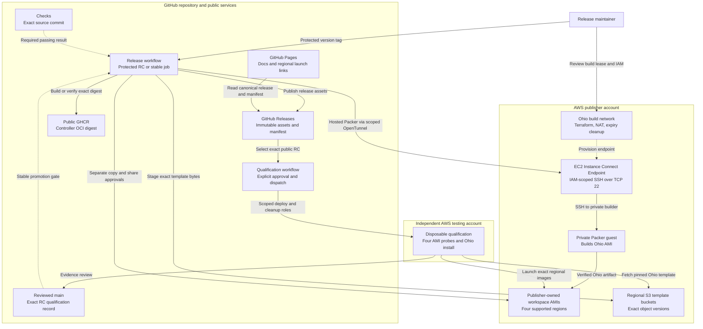
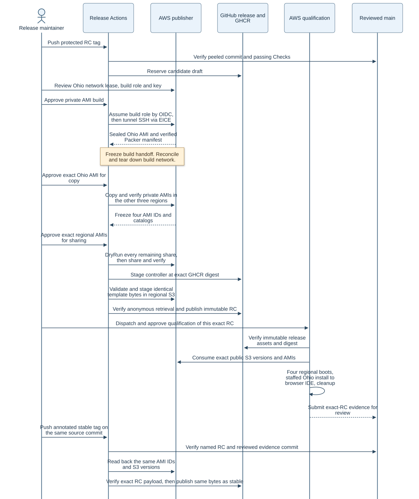
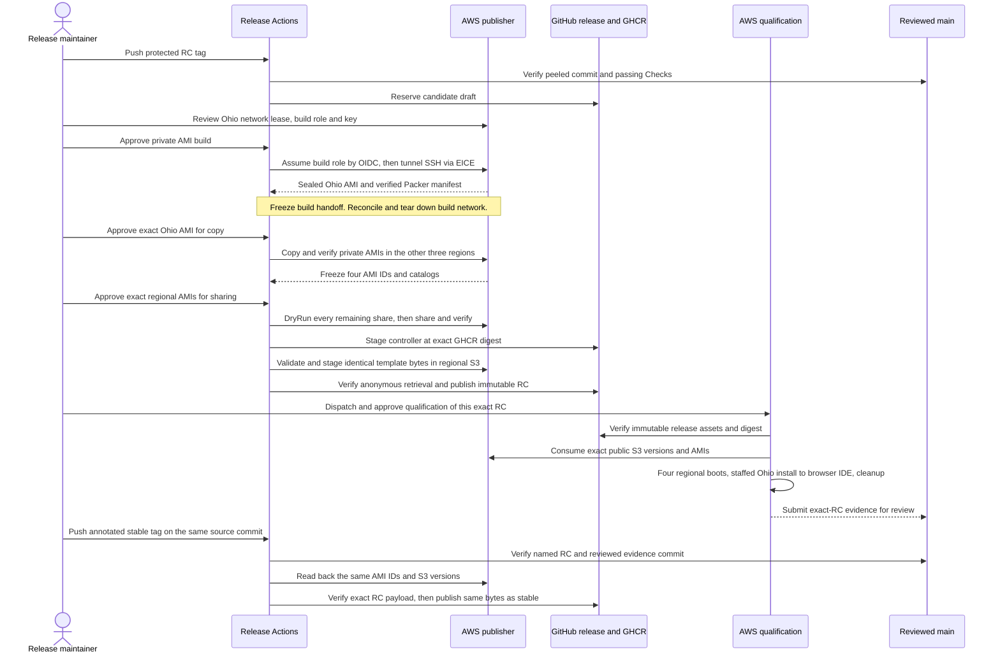
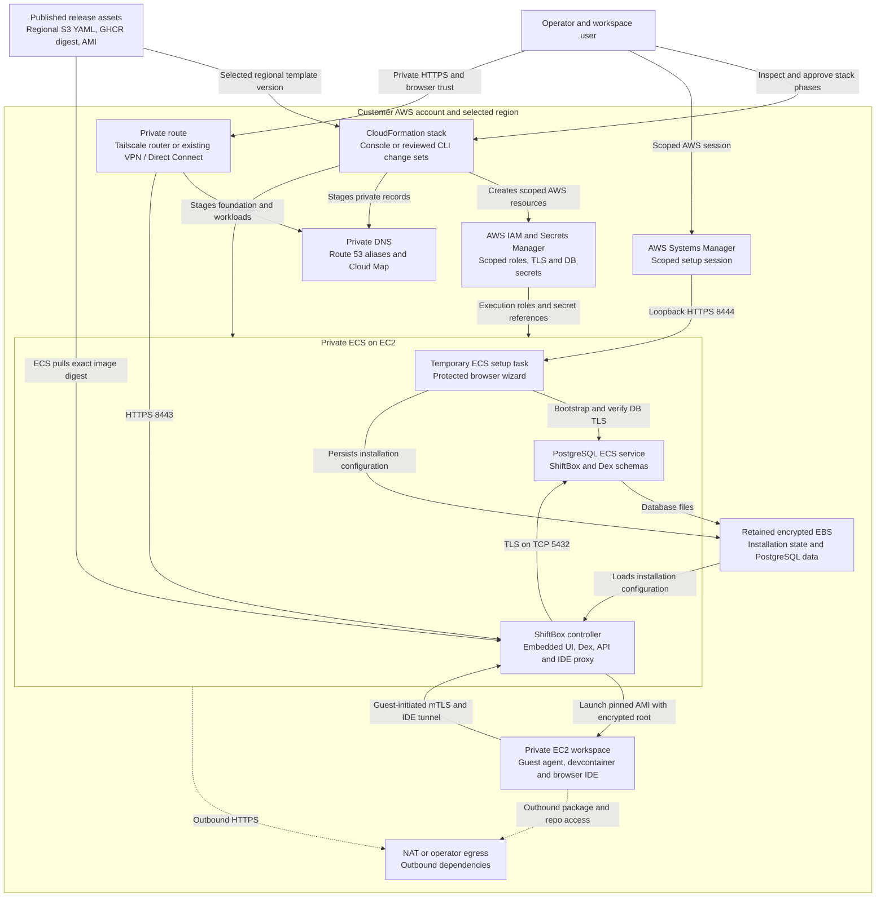
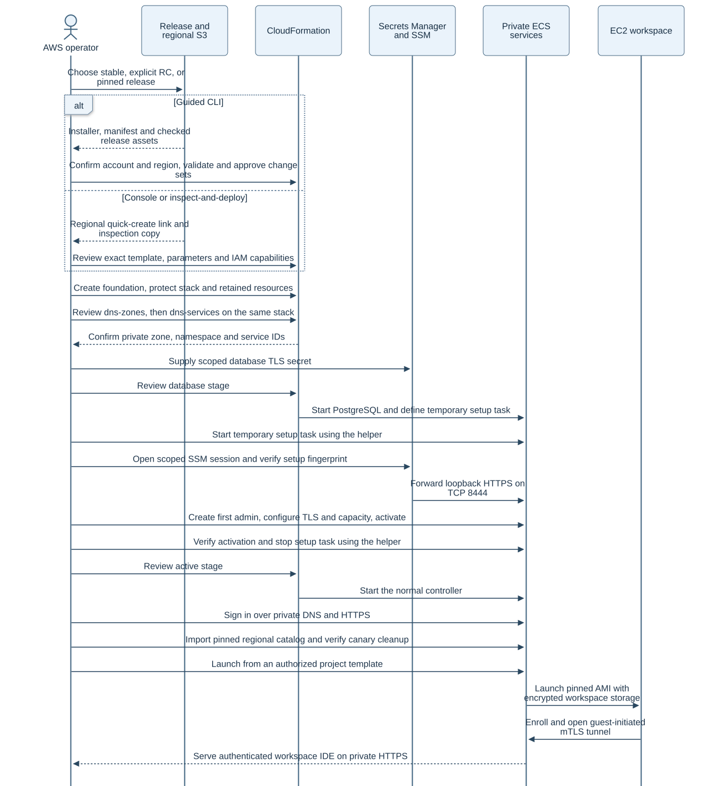
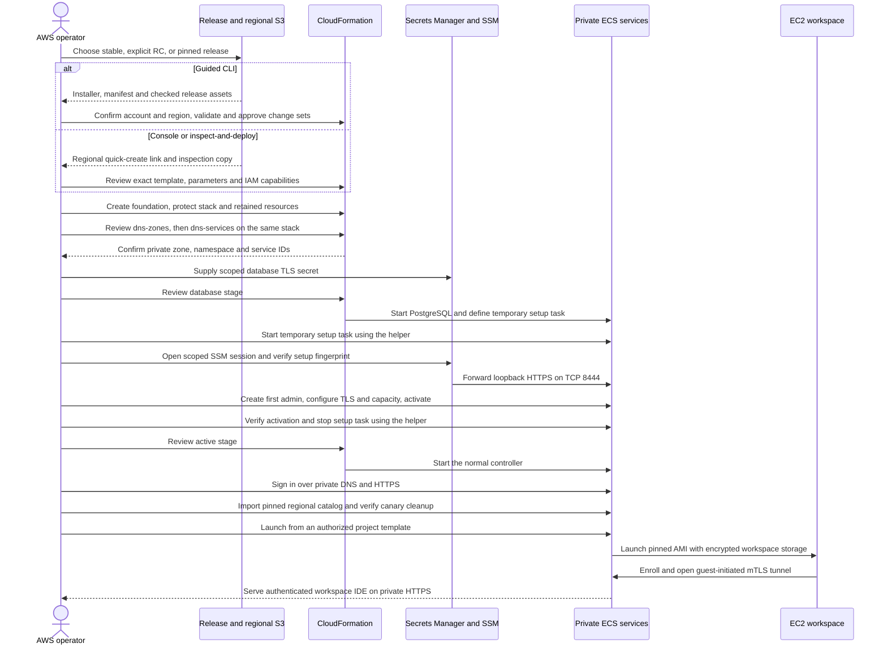

# ShiftBox AWS deployment architecture

The release maintainer builds and publishes a candidate from GitHub Actions using the ShiftBox publisher account. A separate AWS testing account qualifies that exact candidate. Customers then deploy the pinned release into their own AWS accounts using CloudFormation and reach ShiftBox over a private connection.

This is the public AWS distribution design for review. The hosted Packer network and tunnel are a proposed change. The four publisher template buckets are private, qualification is disabled, and no public candidate has been published.

## Release system

[Open full-size diagram](diagrams/aws-release-system.svg)

Mermaid source

| Boundary | Responsibility |
| --- | --- |
| GitHub repository | Normal pushes and pull requests run Checks. A protected version tag starts release preflight, which verifies the maintainer, tag, source commit, and passing Checks before granting write credentials. GitHub Pages publishes documentation from reviewed main through a separate workflow. |
| Publisher build in Ohio (`us-east-2`) | A standard GitHub-hosted job assumes the build role through GitHub OIDC. Packer launches one private EC2 guest. Packer's local SOCKS bridge opens an IAM-scoped EC2 Instance Connect tunnel to that guest on TCP 22. A temporary NAT gateway provides package egress. An attempt-scoped Scheduler and Lambda provide expiry cleanup, and the operator reconciles the Terraform state afterward. |
| Publisher artifacts in four regions | Separate approved roles build, copy, and share the workspace AMIs. A separate template role stages identical CloudFormation bytes in the versioned S3 buckets in `us-east-1`, `us-east-2`, `us-west-1`, and `us-west-2`. The planned public S3 policy grants read access only to published launch artifacts. The AMI backing snapshots are shareable. Customer-launched storage is encrypted in the customer account. |
| Public distribution | GitHub Releases holds the Bash installer, inspectable CloudFormation YAML, support archive, and distribution manifest. The manifest binds the controller's public GHCR digest, each regional AMI and publisher owner, each exact S3 object version, and the regional console launch links. Pages points readers to the canonical release and its launch links. |
| Independent qualification | A maintainer dispatches the workflow for an exact public RC. Separate deployment and cleanup roles operate on run-owned resources in the testing account. Cross-account launches check all four AMIs. A staffed, fresh Ohio console installation verifies the private browser path through the IDE. Teardown is verified before the evidence is approved on main. A separate cleanup path covers cancelled or lost runs when explicitly enabled. |

The publisher also fences the build by account, region, attempt tags, reviewed subnet, endpoint, and a temporary SSH key. The key's public half is imported into EC2. The private half comes from the protected GitHub environment and is removed from the job's temporary directory on exit. The guest receives no instance profile and accepts SSH only from the endpoint's security group. [Publisher build plan](../../platform/packer/aws/publisher-runner-plan.md) · [Release workflow](../../.github/workflows/release.yml) · [Qualification runbook](../../platform/qualification/README.md)

## Release sequence

[Open full-size diagram](diagrams/aws-release-sequence.svg)

Mermaid source

After the Ohio build, the workflow freezes the verified Packer output before regional copy. It then freezes the four regional AMI identities before sharing. The public prerelease becomes the canonical candidate when its complete assets and anonymous downloads pass verification. The first release uses the selected tags `v1.0.0-rc.1` and `v1.0.0`.

The stable tag names the validated RC and the reviewed evidence commit, and resolves to the RC's source commit. Stable publication independently rechecks the evidence, the controller digest, and the four regional AMIs and S3 versions. It copies identical GitHub asset bytes and reuses those existing AWS and GHCR artifacts. A changed payload requires a new RC. Stable is the default installer selection once it exists. [Release publication contract](../../specs/010-public-aws-distribution/contracts/release-publication.md)

## Customer installation

[Open full-size diagram](diagrams/aws-installation-system.svg)

Mermaid source

CloudFormation provisions the private VPC, service and workspace subnets, ECS host, named roles with permissions boundaries, retained encrypted volume, DNS, and workloads in the selected customer region. The ECS host runs the setup task, PostgreSQL, and the controller at their respective stages. Each workspace has its own private EC2 instance and uses the regional workspace AMI pinned by the release. The setup task configures the installation, and the controller brokers authenticated IDE traffic after activation. CloudWatch receives workload logs. [Customer CloudFormation template](../../platform/cloudformation/aws/template.yaml) · [Workspace lifecycle and providers](workspace-lifecycle-and-providers.md)

| Traffic | Private path and trust |
| --- | --- |
| Initial browser setup, TCP 8444 | An authorized operator starts a temporary ECS task and uses AWS Systems Manager to forward a local HTTPS port. The operator verifies the setup certificate fingerprint before opening the wizard. |
| Console, IDE, previews, and repair, TCP 8443 | Clients route through the optional Tailscale subnet router or an operator-managed VPN or Direct Connect path. Route 53 and Cloud Map provide private resolution. The guided no-domain path uses tailnet split DNS (TCP and UDP 53 to the router) and one-time client trust in an installation-specific browser CA. |
| PostgreSQL, TCP 5432 | Setup and controller connect to the database using its own TLS trust. Scoped Secrets Manager references supply database credentials and key material. |
| Workspace registration and tunneling, TCP 19443–19447 | The workspace agent initiates enrollment and mTLS connections from the workspace security group to the controller. The controller proxies IDE traffic to the workspace over that channel. |
| Dependency egress | Private workloads use the stack's optional NAT gateway or operator-provided egress to reach required AWS APIs, registries, package sources, and authorized repository services. |

[Private networking and browser trust](../../docs/site/private-access.md) · [Certificate and guest trust design](certificates-and-guest-trust.md)

## Customer installation sequence

[Open full-size diagram](diagrams/aws-installation-sequence.svg)

Mermaid source

The Console uses the regional version-pinned launch link. The guided shell installer verifies the release payload and AWS account and region, shows CloudFormation change sets for approval, and supports continuation using the same working directory and stack identity. The inspection path uses the same template and checksum. The customer deployment uses CloudFormation throughout.

The operator advances one stack through foundation, DNS zones and namespace, DNS services, database, and active. The setup wizard runs while the normal controller is stopped. After signing in over private HTTPS, the operator imports the pinned catalog, waits for the workspace canary and its cleanup, and selects the validated image in a resource profile and project template. Repository-backed workspaces additionally use an operator-owned GitHub App and the workspace owner's authorization. [Install and open a workspace](../../docs/site/install.md) · [Public install contract](../../specs/010-public-aws-distribution/contracts/public-install.md)
