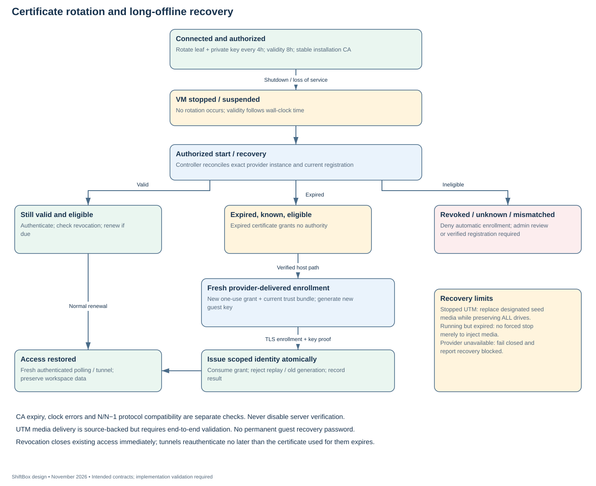

# Certificates and guest trust

Status: design for user review; not implemented or operationally validated. The accepted policy separates uploaded browser HTTPS certificates from installation-issued internal mTLS certificates. The protocol details below are engineering proposals under the delegated implementation responsibility; their release gates remain mandatory.

Read this alongside the [design readback](design-readback.md), [architecture and communication](architecture-and-communication.md), [operations and recovery](operations-state-and-recovery.md), and [validation and engineering defaults](validation-and-engineering-defaults.md).

## Two certificate lifecycles

| Purpose | Certificate authority and custody | Replacement policy |
| --- | --- | --- |
| Management, IDE and authenticated preview HTTPS | Administrator-uploaded certificate chain and matching private key; validated for configured service hostnames. | Administrator replaces through the UI; notify administrators when 30 days remain. |
| Controller–guest internal mTLS | Installation CA generated at setup; each guest generates its own private key. | Replace client/server leaves and their private keys every four hours; eight-hour leaf validity provides bounded overlap and retry time. |

The installation CA remains stable across ordinary internal leaf rotations. It is not replaced every four hours. Eight-hour validity is a selected product policy, not an X.509 requirement. Browser certificates do not inherit this internal rotation schedule.

First launch without supplied HTTPS material exposes only a loopback HTTPS setup UI using a temporary generated certificate that the operator explicitly trusts. Normal network access begins only after validating the uploaded certificate/key pair and hostname coverage. Initial certificate/key file inputs provide an optional operator path. There is no silent HTTP or temporary production-certificate fallback after expiry. HTTPS needs a usable certificate before the browser can reach an upload page. [Go HTTPS](https://pkg.go.dev/net/http#Server.ListenAndServeTLS), [certificate/key validation](https://pkg.go.dev/crypto/tls#LoadX509KeyPair).

The internal endpoint uses certificate selection separate from browser HTTPS. TLS selects a server certificate before routing an HTTP path; assigning different URL paths alone does not implement these two lifecycles. Exact listeners, names and routing are delegated engineering choices. [Go TLS configuration](https://pkg.go.dev/crypto/tls#Config).

## Connected operation and expiration

An enrolled agent renews before expiry using its current valid identity and current workspace authorization. It generates a new key for replacement, installs the result atomically and retries transient failures within the remaining validity window. The controller chooses the issued identity and scope; a CSR does not authorize arbitrary subjects.

Revocation immediately closes polling and proxy access. Certificate replacement alone does not reauthenticate an established tunnel: reconnect or otherwise complete fresh authentication no later than the certificate used for that connection expires. Current authorization also applies to resumed TLS sessions. Go's `VerifyConnection` runs on resumed connections, whereas `VerifyPeerCertificate` does not. [TLS configuration callbacks](https://pkg.go.dev/crypto/tls#Config).

A stopped or suspended VM cannot rotate credentials. Expiration follows wall-clock time, not accumulated VM uptime. After a long stop, an expired certificate is diagnostic history, never authority to renew itself. Ordinary certificate verification remains enabled. [Go X.509 verification](https://pkg.go.dev/crypto/x509#VerifyOptions).

## Recovery states

| Observed state | Required behavior |
| --- | --- |
| Stopped; certificate still valid | On an authorized start, authenticate, check current registration/revocation and renew immediately if due. |
| Stopped; certificate expired | Verify the exact known provider VM, current ownership and enrollment eligibility. Deliver a fresh one-use enrollment grant before starting it. |
| Revoked identity | Deny access and automatic re-enrollment. Require explicit administrator remediation and fresh authorization. Provider stop/delete remains available. |
| Deleted, unknown or mismatched VM | Deny enrollment. Do not adopt resources from guest-supplied identifiers alone. |
| Running; disconnected until expiry | Deny expired mTLS access. Use only a separately validated provider delivery route, or show recovery requiring an authorized stop/restart. Do not force-stop a running workspace merely to replace enrollment media. |
| Host/provider unavailable | Retry reconciliation and report blocked recovery. Do not substitute an expired credential or a permanent guest recovery password. |
| Guest trust bundle obsolete or CA expired | Restore trust through the authorized provider path; do not disable server verification. Issuance requires a valid installation authority. |
| Clone or copied guest state | Treat a provider clone as a new instance requiring new registration and enrollment. Copied credentials do not authorize adoption. |
| Management backup restored | Apply the administrator-reviewed recovery gate. Archived grants, sessions and identity state do not automatically regain authority. |

A failed recovery preserves workspace data and exposes the reason. Expiry alone neither authorizes deletion nor overrides maintenance, retention or user-access policy.

## Proposed re-enrollment protocol

1. **Authorize the operation.** Reconcile installation, workspace, provider instance, ownership and resource generation. Confirm the registration remains eligible (not deleted or revoked) and enrollment is permitted; the VM itself may be stopped. Check revocation and deletion state before preparing delivery.
2. **Prepare fresh material.** Create a short-lived, single-use grant bound to that operation and identity generation. Deliver it with the controller endpoint and current trust bundle through the verified host/provider path, separately from the reusable image.
3. **Generate the guest key.** The guest creates a new private key and proves possession when submitting its request. The controller consumes the grant atomically and issues only the recorded workspace identity.
4. **Finish durably.** Record issuance and the active identity generation, invalidate superseded grants, and remove temporary delivery material when safe. Keep token values out of logs and reusable artifacts.
5. **Handle interrupted exchanges.** A retry can recover the same result only with the same transaction/key proof; otherwise obtain a new provider-authorized grant. A lost response must not permit reuse with another key.

An initial **15-minute grant lifetime** is an engineering default subject to measured amd64-emulation boot validation, not an independently accepted hard requirement. Mint immediately before a start attempt, not when shutting down for an indefinite period. Timeout requires a newly authorized attempt; it does not extend the old grant.

This follows established separation between enrollment and renewal. SPIRE's join-token attestor uses server-generated one-use tokens, while its server independently configures agent certificate TTL. Its trust rebootstrapping requires suitable attestor/server support and trusted bootstrap material. These are precedents, not a decision to install SPIRE. [Join-token attestor](https://github.com/spiffe/spire/blob/main/doc/plugin_server_nodeattestor_jointoken.md), [server configuration](https://spiffe.io/docs/latest/deploying/spire_server/), [agent rebootstrapping](https://spiffe.io/docs/latest/deploying/spire_agent/#rebootstrapping).

Similarly, Vault certificate authentication calls normal X.509 verification. Smallstep disables renewal after expiry by default; its CLI's “offline” renewal requires local CA configuration and signing keys. Neither supplies a reason to place CA signing material in ShiftBox guests or accept expired guest certificates. [Vault implementation](https://github.com/hashicorp/vault/blob/main/builtin/credential/cert/path_login.go#L896), [step-ca configuration](https://smallstep.com/docs/step-ca/configuration/#configuration-options), [offline renewal requirements](https://smallstep.com/docs/step-cli/reference/ca/renew/).

## UTM delivery: supported capability, unvalidated integration

The stopped-VM candidate is fresh enrollment media delivered through UTM's AppleScript configuration interface. Public documentation allows configuration updates while stopped. Pinned UTM 5.0.8 source assigns a supplied source URL to an existing QEMU drive and saves the configuration. This establishes a plausible integration route, not proof that ShiftBox delivery already works. [UTM reference](https://docs.getutm.app/scripting/reference/), [pinned configuration implementation](https://github.com/utmapp/UTM/blob/v5.0.8/Scripting/UTMScriptingConfigImpl.swift).

**The adapter must preserve the complete drive list.** The same implementation removes omitted drives when applying an identified-element list. Submitting only the replacement seed drive could detach workspace drives. Use fresh media and replace its designated source while stopped; never overwrite media actively opened by QEMU. Validate bookmarking, import/copy behavior, permissions, visibility after boot and cleanup on the exact supported version.

Do not invent a `utmctl` seed-attachment command: its documented `attach` command redirects serial input/output. `file push` and `exec` require QEMU guest agent and a running guest; they are possible alternative recovery capabilities only after separate validation. [UTM scripting commands](https://docs.getutm.app/scripting/scripting/).

The platform image needs a narrowly scoped boot-time ShiftBox enrollment/recovery reader. Cloud-init supports local seed media, but ordinary user-data does not automatically rerun with an unchanged instance ID. Do not reset first-boot state or change machine identity just to deliver another grant. [NoCloud semantics](https://docs.cloud-init.io/en/latest/reference/datasources/nocloud.html).

## Trust limits, clocks and long-lived installations

Provider-mediated enrollment trusts the controller and provider host. It is not hardware-backed attestation that guest software is uncompromised. Guest root can read its own key or grant; adding a VM UUID does not make copied credentials unclonable. Protect host delivery material, invalidate old enrollment generations and detect conflicting sessions. Do not claim stronger clone resistance without additional evidence.

Validate host/guest time after long shutdown and suspension. A badly wrong clock produces an actionable clock-recovery failure, not relaxed certificate checks. Unauthenticated network time must not become enrollment authority. Clock correction and certificate issuance remain separate operations.

A stable CA is not immortal. Track authority expiry and compromise independently; cap leaves at the issuer boundary. Before planned CA retirement, distribute successor trust to connected guests. Long-offline guests receive current trust through provider-controlled recovery. If no valid authority is available, repair the installation authority before issuing leaves. These lifecycle procedures are required even though general application encryption-key rotation is deferred.

After a normal controller restart, its retained valid CA can issue a fresh internal server leaf before accepting connections. That is authorized local issuance, not renewal based on an expired client identity. Outstanding enrollment state must be durable or conservatively invalidated.

## Release compatibility and acceptance

The controller supports current and immediately previous published agent releases, N/N−1. Every retained workspace, including stopped or unreachable workspaces, must reach N before the next controller upgrade. Recovery must therefore work on N−1 before ordinary self-update: start, re-enroll if necessary, authenticate, upgrade, verify, then restore the prior stopped state when maintenance requires it. Bypassing the upgrade gate does not create an arbitrary-version recovery guarantee.

Release acceptance must demonstrate fresh/replacement media delivery without workspace-disk changes; short and prolonged stops; controller/host restart; suspension and clock skew; stale trust; N−1 recovery; replay and lost responses; revoked/deleted identities; cloned media; and concurrent start/delete/recovery. Until these pass, automatic long-stop recovery is a design commitment with an implementation gate, not a proven capability. Failure must return an explicit recovery error rather than weaken authentication.
