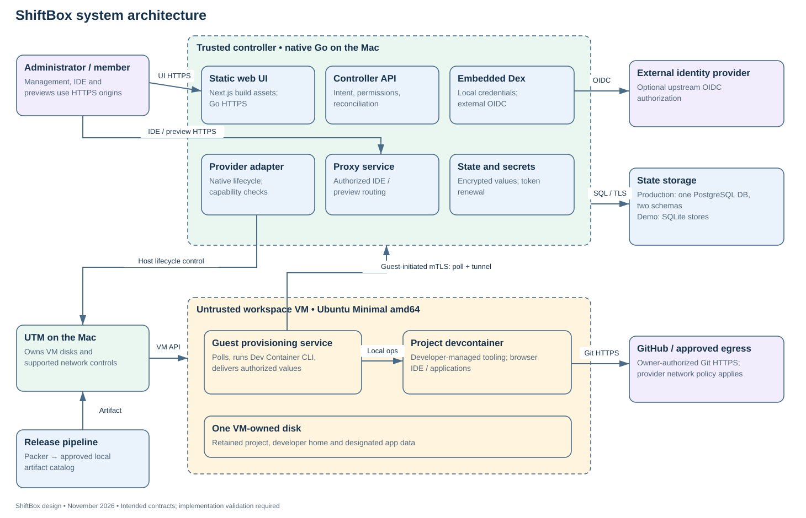

# ShiftBox design readback

**Status:** Design synthesis for user review, November 13, 2026. Decisions through Q155 and the subsequent Mantine component-library selection are incorporated. This is a greenfield design; it is not implementation authorization or a claim that the integrations have been validated.

ShiftBox is a self-hosted cloud development environment that owns workspace lifecycle while delegating machine infrastructure to VM providers. Its first supported deployment is a native Go controller beside UTM on a logged-in, awake Mac. Each workspace receives its own Ubuntu VM and one primary development container. The browser UI, controller, proxy and provider adapter ship as one product; processes and helper utilities may be separated where necessary.

## Read the design

| Document | Purpose |
| --- | --- |
| [Technology decisions](technology-decisions.md) | Selected dependencies, their roles, ownership, version status and unresolved technology choices |
| [Architecture and communication](architecture-and-communication.md) | Guiding choices, components, channels and trust boundaries |
| [Workspace lifecycle and providers](workspace-lifecycle-and-providers.md) | Images, provisioning, reconciliation, retained data, networking, deletion and maintenance |
| [Identity, access and browser security](identity-access-and-browser-security.md) | Dex, accounts, sessions, permissions, browser isolation and previews |
| [Templates, secrets and Git](templates-secrets-and-git.md) | Shared templates, three-scope lookup, developer freedom and OAuth token handling |
| [Certificates and guest trust](certificates-and-guest-trust.md) | Browser TLS, internal mTLS, offline recovery, revocation and CA limits |
| [Operations, state and recovery](operations-state-and-recovery.md) | Database setup, encryption, backup/restore, updates, notices and failure behavior |
| [Validation and engineering defaults](validation-and-engineering-defaults.md) | Explicit defaults, release gates, remaining technical choices and deferred scope |
| [Decision record](shiftbox-design-decisions.md) | Full interview history, outcomes, research and provenance |

The seven diagrams are delivered as SVG files with editable Mermaid (`.mmd`) companions in `diagrams/`: system architecture, workspace communication, trust boundaries, workspace lifecycle, certificate recovery, secret resolution, and setup/recovery.

## The shared understanding

1. **Simplicity is the priority.** Go implements controller and guest services. React/Next.js/TypeScript with **Mantine components and shared theming** builds static assets served by Go HTTPS; there is no production Node UI server. ShiftBox retains durable reconciliation, rather than attempting to remove every control-plane responsibility with Kubernetes.
2. **The VM is the workspace execution boundary.** One VM, one primary devcontainer, VS Code Browser. The complete VM—including its agent—may be compromised. Guest authentication does not prove truthful telemetry or make delivered secrets safe from guest root.
3. **Provider independence is an internal contract.** Compiled adapters manage VM creation, inspection, start, stop, deletion and supported networking. UTM comes first; EC2 and Linux/container-hosted production controllers follow in phase II. Unsupported network restrictions are not offered.
4. **Work survives rebuilds and restarts, not VM destruction.** Project files, the actual developer home and explicitly persistent application mounts reside on the VM-owned disk. Developers must push work to Git before destruction. Management backups exclude VM disks.
5. **Authority stays in the controller.** Embedded Dex handles authentication; ShiftBox handles membership, ownership and resource/action permissions. Admin and member are the initial roles. Owner-private IDEs and previews require authenticated access; administrator connections are separately permissioned and audited.
6. **Secret access is intentionally broad within an authorized context.** Effective lookup is **User → Project Template → Organization**, with no workspace secret scope. Any code in a workspace may obtain its owner's authorized effective values. Templates and injection settings are not a narrower authorization boundary.
7. **Developers configure their tools.** The GitHub App grants developer Git/PR/workflow permissions; ShiftBox exposes current user OAuth access tokens and persists encrypted access/refresh tokens for renewal. It does not bundle `gh`, manage PRs or promise managed LFS/fork workflows.
8. **Persistence has two profiles.** Production uses one externally operated PostgreSQL database with separately owned ShiftBox and Dex schemas. Demo/very-small installations use SQLite. Restricted local bootstrap preserves the first administrator through production setup; populated-demo migration is deferred.
9. **Certificates have separate lifecycles.** Uploaded web TLS certificates are managed through the UI, with 30-day expiry notices. Internal client/server leaf certificates and keys rotate every four hours, have eight-hour validity, and use a stable installation CA.
10. **A stopped VM does not rotate.** Its leaf may expire. On an authorized return, ShiftBox verifies the provider instance and delivers a fresh, single-use enrollment credential. Expired certificates, copied IDs and revoked registrations never authorize recovery on their own.
11. **Destructive cleanup and upgrades have different authority.** Configured retention may escalate to provider-enforced deletion after grace and final checks. Maintenance upgrades may not force-kill unsafe work. Failed cleanup or updates remain visible and retryable; uncertainty does not release reservations.
12. **Design agreement is followed by proof.** Exact UTM/Packer provisioning, seed delivery, network capabilities, identity migration, backup/restore and security boundaries are release gates—not facts established by this interview.

## Research conclusions incorporated

**Long shutdowns:** The supported contract is provider-mediated re-enrollment, not offline certificate rotation or a long-lived guest recovery password. UTM's pinned source supports changing an identified drive's source while stopped, which provides a credible recovery-media route. It still requires end-to-end validation. A running VM that loses trust is not silently stopped just to inject media; it reports a recovery condition or uses a separately validated host channel. See [the full certificate design and sources](certificates-and-guest-trust.md).

**External OIDC:** Administrators configure the upstream authorization interval. The initial engineering default is **four hours**. Research found no universal industry-wide value: session lifetime, inactivity, authentication freshness and token lifetime are different clocks. Successful upstream SSO may satisfy the authorization check; a token refresh or broker-local session alone must not silently extend it. This is not an assurance-level compliance claim or guaranteed directory-disablement detection. See [the default rationale](validation-and-engineering-defaults.md#external-identity-default-rationale).

## Boundaries that remain deliberate

No HA/shared SaaS, migration of the CloudBox codebase, platform-managed Compose, extra IDEs, public workspace sharing, automatic workspace-data backups, platform-OS replacement, production Node UI runtime, managed developer tooling or PR product is included. Optional MFA and application encryption-key rotation are phase II. Scaling/load tests remain deferred until the product is fully implemented; functional and security validation are required before claiming a supported release.

The default values and implementation patterns in these documents are engineering proposals under the delegation accepted at Q155. They cannot override accepted behavior. If validation requires a weaker trust boundary, changed data-loss contract or additional product scope, that tradeoff returns for a decision.

## Review and approval

The design decision frontier is closed at the product-contract level; the requested offline-VM research is incorporated as a bounded engineering design and validation gate. **Final readback confirmation remains outstanding.** Review the certificate recovery contract, secret-exposure boundary, external-session default and operational safeguards in particular. Implementation requires a separate authorization after shared understanding is confirmed.
