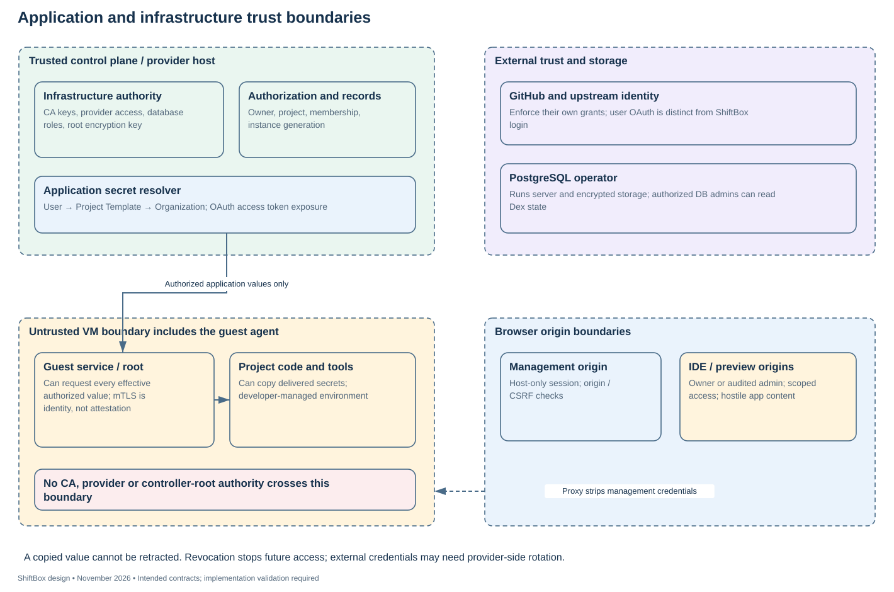

# Identity, access and browser security

**Status: Design synthesis for user review; not implementation authorization.**

ShiftBox authenticates people through OIDC and separately decides what they may do. Embedded Dex owns local credentials and brokers the external identity option; ShiftBox owns membership, roles and resource authorization. Successful sign-in alone grants no workspace access. See the [design readback](design-readback.md) and [communication architecture](architecture-and-communication.md). Authoritative decisions: Q24, Q29, Q34, Q51, Q73–Q85, Q136–Q147 and Q152–Q155.

## Identity and admission

Local accounts use email-address login. The operator supplies the first administrator's email before setup generates a unique temporary password, delivered locally. The server restricts the initial session until that password changes. Restart and restore never reset the chosen password. Administrators create subsequent local accounts with an explicit role; these accounts do not require a second membership approval. Public registration and email delivery are outside phase one (Q84–Q85, Q136, Q140).

Externally authenticated people request membership, and an administrator approves their member or administrator role. Stable issuer, subject and connector bindings identify accounts; email is not an automatic account-merging key. Linking identities requires administrator approval. OIDC defines stable identity using issuer and subject rather than mutable profile attributes; connector behavior must still be verified. [OIDC claim stability](https://openid.net/specs/openid-connect-core-1_0.html#ClaimStability).

Users may change their local passwords. An authorized administrator can generate a one-time displayed temporary password for private delivery, revoking affected sessions and requiring a new password. Last-administrator recovery is a local operation authorized by protected installation state and database access: it recovers an existing administrator, preserves data and records an audit event. It is not a public recovery endpoint or an arbitrary administrator-creation mechanism (Q141–Q142).

## Accepted permissions

Checks use resource/action permissions beneath the initial predefined roles. Workspace connection is distinct from lifecycle administration (Q29, Q34, Q101, Q111–Q113).

| Action | Member | Administrator |
| --- | --- | --- |
| Connect to IDE or private preview | Own workspace | Own workspace; another owner's workspace only through explicit audited connection permission |
| Manage workspace lifecycle | Own workspace within policy | Organization workspaces within policy |
| Manage personal secrets | Own secrets | Own secrets; administration does not change guest owner context |
| Edit templates and project secrets | Owned templates | Organization templates |
| Launch shared templates | Templates explicitly shared with member | Subject to launch authorization and infrastructure policy |
| Manage organization secrets, membership and infrastructure settings | No | Yes |
| Redisplay saved secret values in management UI/API | No | No |

Workspaces remain owner-private. Sharing a template does not share an existing workspace. Custom-role editing, collaborative workspace access and public preview links are deferred. Audit events record identity, action and resource context without secret values.

## Session expiry and offboarding

Q152 makes the external identity reauthorization interval administrator-configurable. **Four hours is the proposed product default**, not an industry-wide standard. A successful actual upstream authorization flow must occur within the configured interval; refreshing tokens alone does not reset this deadline. Implementation must prove that Dex reaches the configured upstream provider rather than merely reusing a local broker session.

Upstream SSO may satisfy that flow without another password prompt. This policy bounds time since provider acceptance; it cannot promise instantaneous detection of directory disablement or universal forced password entry. OIDC distinguishes authorization requests from token refresh; provider and broker behavior require validation. [OIDC authentication](https://openid.net/specs/openid-connect-core-1_0.html#Authentication).

If the deadline cannot be met, ShiftBox closes browser, API, IDE and preview access while VM computation may continue. Explicit ShiftBox membership disablement is the immediate offboarding control: revoke access, close existing sessions and request provider-enforced stops of owned workloads. Preserve files under retention policy and expose stop failures (Q65, Q152).

## Browser boundaries

Management, each workspace IDE and each preview service use separate browser origins. Preview and IDE entry require the owner or explicit audited administrator connection permission. Narrow service access must not expose management credentials to guest applications. Host-scoped credentials, origin/CSRF checks and authenticated WebSocket upgrades must withstand hostile content on sibling service origins; separate origins alone are insufficient (Q81, Q147).

Revocation must terminate established access, not merely reject a later login. The proxy remains the user ingress path; browser authentication never authorizes a general guest-management shell. Browser TLS and VM mTLS have independent lifecycles, described in [certificates and guest trust](certificates-and-guest-trust.md).

Dex credential ownership does not imply field-level encryption of its live records. Production uses scoped database access, verified PostgreSQL TLS and operator-encrypted storage. [Operations and recovery](operations-state-and-recovery.md) defines bootstrap, live privacy and guarded restore. [Validation and defaults](validation-and-engineering-defaults.md) must prove setup restrictions, identity binding, offboarding, session expiry, hostile-preview isolation and keyboard accessibility before release.
