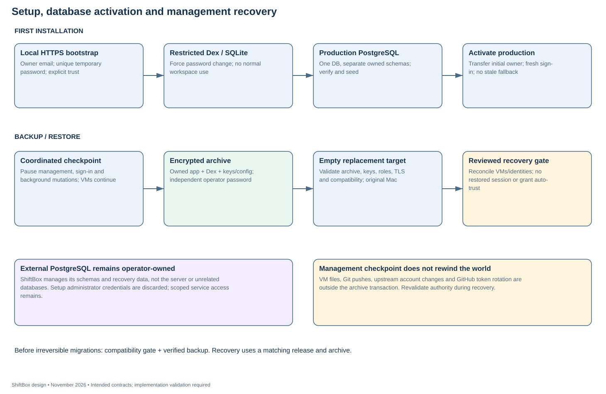

# Operations, state and recovery

**Status:** Design synthesis for review. Main decisions: Q69–Q75, Q115–Q125, Q133–Q146 and Q153–Q154. [Readback](design-readback.md)

## Deployment and database ownership

Phase one is manually installed/started on a logged-in awake Mac with UTM available. Preserve the installation directory across releases. Production uses one externally operated PostgreSQL database with separate `shiftbox` and `dex` schemas and scoped owner accounts; names are engineering defaults. SQLite supports demo/very-small installations, with separate application and identity files. There is one active controller in both profiles.

ShiftBox owns its schema/migration/seed operations, not PostgreSQL server deployment, backup of unrelated databases, server upgrades or infrastructure HA. Accept an empty supplied target or optionally create owned databases/roles using adequately privileged setup credentials. Discard elevated credentials afterward; retain only required scoped service credentials in protected configuration. Dex needs ownership/DDL privileges for its own startup migrations; do not claim a read/write-only account is sufficient.

Dex's inspected PostgreSQL configuration has no schema/search-path field. Configure role-and-database-specific search paths, remove privileges on unrelated/writable schemas and validate placement with fresh connections before activation. This is an integration to prove, not a fictitious Dex option. [Dex SQL configuration](https://github.com/dexidp/dex/blob/v2.46.1/storage/sql/config.go), [PostgreSQL role defaults](https://www.postgresql.org/docs/current/sql-alterrole.html)

## First-run state machine

1. Collect the first administrator email through local setup/configuration. Generate one unique temporary password and display/store it only through the protected local bootstrap path.
2. Use supplied certificate/key files, or loopback-only temporary HTTPS with explicit local trust. Never accept setup passwords, DB credentials or private keys through unauthenticated plain HTTP.
3. Authenticate against restricted local Dex/SQLite and force a password change. No normal accounts, templates, workspaces or application secrets are enabled yet.
4. Select demo SQLite or production PostgreSQL. Production setup privately collects connection/provisioning inputs, verifies TLS/privileges, seeds schemas, and transfers only the initial owner and setup state.
5. Preserve the stable owner identity and changed password hash; this is not a populated-demo database migration. Validate, durably activate the production configuration, retire bootstrap sessions and require fresh sign-in. Never silently fall back to the old SQLite authority after activation.
6. Validate uploaded production browser certificate/key and all configured hostnames before normal network exposure. Optional initial certificate files satisfy this prerequisite without a temporary certificate.

Database creation, schema migration and local configuration activation cannot all share one database transaction. Use recoverable staged setup, target-ownership checks and durable activation records. Retrying never overwrites unrelated objects, resets the owner password or creates two authoritative installations.

## Encryption and live-state protection

Application secret values and persisted OAuth token material use authenticated encryption, contextual binding and key versions. Metadata is not promised field encryption. Keep a cryptographically random installation key in a protected persistent file outside the database, or accept an operator-supplied mounted key file. Do not bake a shared key into the executable/image or place the only key in a disposable container layer.

Enforce platform-appropriate ownership/permissions; a raw key should not appear in command-line arguments or diagnostic logs. Missing/wrong keys for existing ciphertext fail clearly. A key stored beside the application is not protection against a compromised controller account/root; it reduces database-only exposure. Application-key rotation is phase II, separately from TLS, GitHub token renewal and Dex signing-key behavior.

Dex's database contains identity-sensitive records not automatically covered by the application encryption layer. Production requires restricted access, verified DB TLS and operator-provided encrypted storage. Authorized DB administrators can read live Dex records. Demo storage protection follows its host; make that limit visible. [Dex storage](https://dexidp.io/docs/configuration/storage/), [PostgreSQL encryption options](https://www.postgresql.org/docs/current/encryption-options.html)

## Backup contract

A manually initiated UI/CLI backup creates one independently password-encrypted management archive. The operator supplies and separately retains the password; ShiftBox does not retain it. An established authenticated streaming format such as age is the engineering baseline, with archive version/manifest and corruption/truncation checks. [age library](https://pkg.go.dev/filippo.io/age)

Include owned application and Dex data, configuration, schema/release compatibility, scoped role/search-path reconstruction information, encryption-key versions—including supplied mounted keys needed by the archive—and CA/trust/OIDC material required for recovery. The archive is highly sensitive even though its outer payload is encrypted. Exclude VM disks, unrelated PostgreSQL data/server state, developer file backups and external identity/GitHub state.

A coordinated checkpoint briefly drains management/sign-in/background writes, including embedded identity and token-state mutations. Capture consistent schema snapshots plus matching local files; resume live activity once secured, then complete encryption/export. Workspace VMs keep computing. Avoid a privileged permanent DB backup account where scoped schema snapshots suffice. Role definitions and local keys are not automatically covered by one database dump.

For PostgreSQL, the engineering baseline is compatible native dump/restore utilities, bundled or validated as explicit prerequisites. Use a shared consistent snapshot when separate scoped exports are necessary. For SQLite, use supported consistent backup/checkpoint operations; do not copy arbitrarily changing live files. Do not promise a fixed pause duration before testing. [PostgreSQL snapshots](https://www.postgresql.org/docs/current/functions-admin.html#FUNCTIONS-SNAPSHOT-SYNCHRONIZATION), [pg_dump](https://www.postgresql.org/docs/current/app-pgdump.html)

## Restore and authority recovery

Phase one restores the same logical installation on the original Mac. An empty replacement PostgreSQL target and replacement connection credentials are allowed. Cross-host failover, VM migration and workspace disk recovery are outside this contract.

Validate the complete archive/password, version compatibility, keys, target ownership and DB prerequisites before activation. Recreate only owned schemas/roles. Never silently overwrite a supplied mounted key or unrelated DB; use a protected destination or the operator's validated matching key. A failed preactivation attempt remains recoverable.

Enter an administrator-reviewed recovery mode. Restored browser sessions, outstanding enrollment grants, stale revocations and obsolete permission state must not automatically regain authority. Gate management mutations, user workspace access and overdue deletion while reviewing identity/membership and reconciling provider resources. Running VMs may continue computing. OAuth refresh state in an old backup may already be invalid at GitHub; revalidate/reconnect rather than claiming the archive reverses token rotation.

## Release and update safety

Preflight each release: platform/provider versions, image/agent compatibility, writable persistent storage, DB connectivity/privileges, backup utility compatibility, key access, browser certificate validity and internal CA lifetime. Preserve persistent state; no fresh installation beside the existing state by accident.

Before irreversible application or Dex schema changes, require a completed, verified management backup and satisfy the all-retained-workspaces-current gate. An old executable alone is not a safe rollback after migration. Recovery uses the matching older release and coordinated archive through the review gate; VM disks and external operations do not rewind. Dex migration rollback is not promised.

The default startup is manual. Optional login startup is an engineering convenience, not a sleep/logout/pre-login availability guarantee. A single downloaded product may extract verified helper utilities into a versioned private directory; this does not authorize silently installing PostgreSQL server or developer tooling.

## Notices, administration and resource pressure

Admins publish systemwide notices. Users can read/dismiss them individually and retain history; dismissal neither proves understanding nor cancels maintenance. Certificate expiry warnings begin at 30 days remaining; expired/invalid certificates remain prominent until valid replacement. Maintenance deadline/progress stays visible on the workspace.

Archived templates are available only in a filtered admin view; existing workspaces retain captured provenance and authorized project-secret access. Permanent purge and owner-transfer features are deferred. Administrators can manage orphaned/archived templates without silently assigning another owner.

Audit and notice retention are configurable. Preserve current authorization, active maintenance, unresolved operations and workspace provenance independently of history cleanup. Storage pressure blocks new allocations and alerts; it creates no permission to delete retained workspace files, identity state or keys. Existing explicitly configured workspace-retention policy remains separate.

## Failure handling

| Failure | Required response |
| --- | --- |
| Controller/DB unavailable | No unsafe mutation or stale SQLite fallback; workloads may compute; proxy/secret reads can fail |
| Missing encryption key | Fail closed for dependent operations; retain ciphertext and offer local recovery |
| Backup cannot establish consistency | Fail visibly; no successful-backup claim or irreversible update based on it |
| Irreversible migration fails | Stop normal operation; use validated recovery procedure, not arbitrary binary rollback |
| Provider response lost | Reconcile authoritative inventory; retain reservations and operation identity |
| Disk pressure | Block new allocations, warn, preserve persistent state; do not silently purge user data |
| Certificate recovery cannot be verified | Block guest access, surface provider/clock/trust recovery; never accept expired identity alone |

See [validation and defaults](validation-and-engineering-defaults.md) for measurable release gates and [certificate recovery](certificates-and-guest-trust.md) for the long-offline path.
