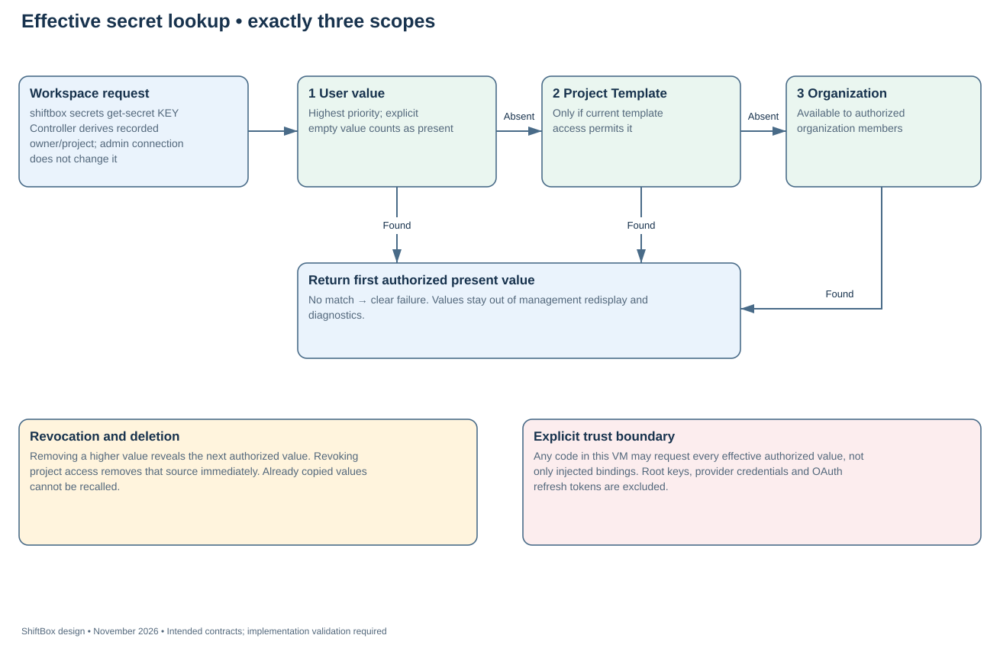

# Templates, secrets and Git

**Status: Confirmed final design; not runtime implementation authorization.**

Templates describe reproducible launches; authorization determines current secret access; GitHub supplies the workspace owner's Git authority. These responsibilities remain distinct. See the [design readback](design-readback.md) and [communication architecture](architecture-and-communication.md). Authoritative decisions: Q90–Q113, Q120–Q139, Q144, Q148 and Q154–Q155.

## Templates and provenance

A user-owned template records repository, launch configuration, environment size and secret references. Owners and administrators edit templates and their project secrets; selected members receive launch permission. Each launch creates an independent owner-private workspace and captures template revision, configuration, resolved resources and references. Later edits affect future launches. Secret values and permissions remain current rather than frozen inside that snapshot (Q100–Q103).

Sharing launch permission also grants use of project secrets, with a visible warning. Personal requirements resolve against the launching user, never the author's personal credentials. Templates contain references rather than plaintext values. Private-repository Git access must be available before reading its devcontainer configuration.

Removing template access immediately prevents new launches and project-secret retrieval; existing workspaces and files survive. Archiving also prevents new launches, but preserves existing grants until explicitly revoked. Archived template details appear only in the administrator's filtered view; an existing workspace may still display its captured project name and revision. Administrators manage orphaned/archived templates; permanent purge and ownership transfer are deferred (Q113, Q137, Q144, Q154).

## Exactly three secret scopes

The effective key space resolves **User → Project Template → Organization**, highest priority first. There is no individual workspace secret store or management UI. The controller derives owner and project context from authenticated VM identity and owned records; guest-supplied identifiers cannot authorize another context. An administrator connecting to a workspace does not switch it to the administrator's personal secrets (Q104, Q111–Q112).

Users manage personal secrets, template owners/administrators manage project secrets, and administrators manage organization secrets. An explicit empty value overrides lower scopes. Deleting an override reveals the next authorized lower value, with that consequence shown before deletion. Revoking project access removes that source while leaving independently authorized user and organization sources available (Q121).

The guest may retrieve **any value authorized in its effective context**, whether or not an application configured an injection binding. The entire VM may be compromised: all those values can therefore be copied. This authority does not include controller infrastructure credentials, root encryption keys, signing keys or identity-service internals. Revocation prevents future delivery but cannot retract copied credentials (Q14, Q104–Q105).

Runtime delivery is technology-specific and file-first, with explicit environment compatibility. The proposed interface name `shiftbox secrets get-secret <name>` returns a value to its authorized caller; this is a design interface, not an implemented command. Management UI/API never redisplays saved values, and audit records exclude values. Application secrets during image builds remain deferred. Reads require the controller; there is no persistent offline retrieval cache or automatic reload of already-injected values (Q90–Q96, Q105, Q155).

Application-level authenticated encryption protects stored values with contextual binding. [Operations and recovery](operations-state-and-recovery.md) defines portable key custody, encrypted backups and live-storage limits. Application encryption-key rotation remains phase II; it is separate from [mTLS rotation](certificates-and-guest-trust.md).

## GitHub authority and token lifecycle

Phase one supports GitHub.com HTTPS Git with a GitHub App, administrator-owned registration/installation and browser OAuth user authorization. OIDC sign-in and GitHub consent are separate. Git runs under the workspace owner's user authority, bounded by app permissions, repository installation coverage and GitHub rules (Q107–Q110).

Accepted app permissions are Contents/Pull requests read-write, Workflows write, and Metadata/Checks/Commit statuses read. They enable developer tools; ShiftBox does not manage PR launch, review, merge or status. Developers install/configure tools including `gh`. No bundled launcher, managed LFS/submodule/fork support or webhook service is implied by token exposure (Q120, Q126–Q132).

Q148 requires encrypted persistence of user access and refresh tokens, automatic renewal where supported and reconnection after revocation or permanent renewal failure. Coordinate renewal per user and expose only the current authorized access token to the guest. Treat it as opaque: the app-signed JWT and signing key are different credentials and never become guest Git credentials.

Refresh replaces the token pair and invalidates the previous pair; developer-managed tools may need to retrieve a replacement. Persistence survives controller restart but does not extend token validity or transparently update copied credentials. [GitHub refresh behavior](https://docs.github.com/en/apps/creating-github-apps/authenticating-with-a-github-app/refreshing-user-access-tokens).

The token-exposure interface remains an engineering choice within these boundaries; no separate credential-broker product or automatic `gh` authentication is added. SSH, Enterprise Server and other Git providers remain deferred. [Validation and defaults](validation-and-engineering-defaults.md) must cover owner context, shared-secret consequences, archival/revocation, fallback and empty values, refresh races, restart persistence and private-repository launch.
