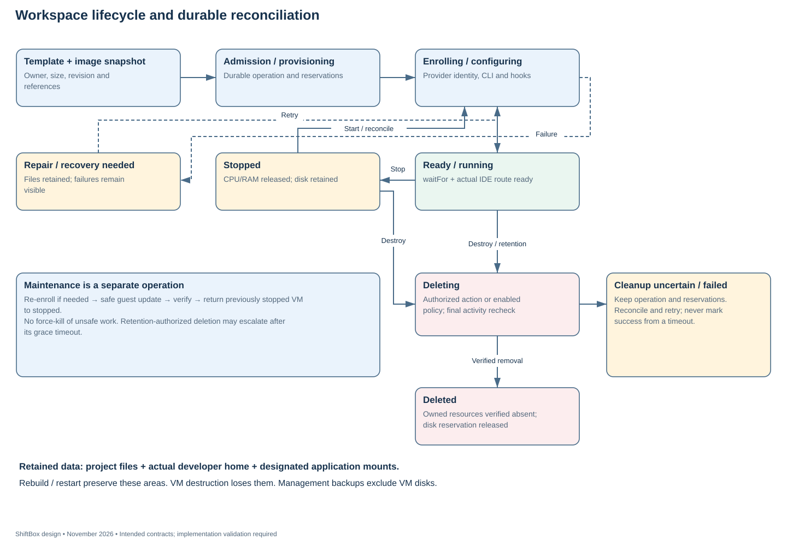

# Workspace lifecycle and providers

**Status:** Confirmed final design. Main decisions: Q4–Q22, Q40–Q60, Q66–Q78, Q83–Q99, Q100–Q103 and Q151. [Readback](design-readback.md)

## Artifacts and runtime baseline

Phase one uses Ubuntu 24.04 LTS Minimal **amd64** under QEMU emulation on the ARM Mac. Pin the exact image revision and digest; no boot-speed or capacity result has been measured. Supported project containers are glibc-based amd64 Linux, with Debian/Ubuntu reference cases. Alpine/musl project containers and platform-managed Compose projects are deferred.

Packer builds reusable platform artifacts in the release pipeline. A pinned UTM-compatible fork of [packer-plugin-utm](https://github.com/naveenrajm7/packer-plugin-utm) must pass the exact selected build/export/import/boot path. Relaxing a version check is not support. The platform contains the guest service, supported container/runtime tooling, independent repair environment and boot-time enrollment reader; it does not contain user secrets or a reusable enrollment credential.

An administrator imports a self-contained artifact with architecture, platform/tool and agent/protocol versions, owned-disk inventory, digests and provenance. Catalog objects are immutable; workspace disk copies are independent writable instances. No remote moving-latest catalog or per-workspace Packer build is required.

The platform OS/image remains pinned for an existing workspace. Publishing a new image affects new workspaces. The guest service is the explicit exception: it self-updates under the controller release contract.

## Templates and admission

A launch records template revision, repository configuration, owner, exact image, resolved CPU/RAM/disk and secret references. Later template/profile edits affect future launches; authorization and secret values remain live.

Administrators define T-shirt sizes and budgets. Reserve CPU/RAM on accepted start until provider-confirmed stop/deletion; account disk until verified deletion. Retain reservations after uncertain outcomes. Over-capacity starts fail clearly—no implicit queue, eviction or resize. Scheduled maintenance obeys the same budgets.

## Desired state and observed state

The diagram is an engineering state model. Keep desired state separate from observed status and phase-specific failure. `Stopped` is not `Deleted`; `Unreachable` is not proof of either.

| Operation | Completion evidence |
| --- | --- |
| Provision | Correct provider VM/owned resources inventoried; unique identity; enrollment completed |
| Start | Provider running, agent authenticated, project setup progresses |
| Open IDE | Agent/container ready, Dev Container `waitFor` reached, actual proxied browser IDE functional |
| Rebuild | Replaced disposable container layers while retained mounts remain intact |
| Stop | Provider confirms stopped; CPU/RAM released, disk retained |
| Destroy | Provider confirms all inventoried workspace-owned resources removed; shared resources preserved |
| Repair | Trusted environment opens retained project without executing failed repository hooks/tasks/extensions |

Use durable operation IDs and workspace generations. Repeated requests return/reconcile the same logical operation; uncertain network outcomes do not trigger blind duplicate creation/destruction. Before committing destructive action, recheck current authorization, activity, policy and desired state.

The standard Dev Container CLI executes image/Dockerfile, Features and lifecycle hooks. Honor the repository's `waitFor` connection gate; later hooks can continue with separate visible progress. TCP reachability alone is not IDE readiness. [Dev Container lifecycle](https://github.com/devcontainers/spec/blob/main/docs/specs/devcontainerjson-reference.md#lifecycle-scripts)

## Storage and repair

One VM-owned persistent disk holds the platform OS and retained areas. Preserve:

- Repository working files.
- The actual developer user's home, including IDE settings/extensions stored there.
- Application data explicitly declared in persistent mounts.

Container layers, image caches, build caches and other paths are disposable. Do not hard-code `/home/vscode` for every image. The illustrative mount layout and validation cases are listed in [engineering defaults](validation-and-engineering-defaults.md).

Reboot, stop/start and rebuild preserve retained data. **VM destruction loses it.** ShiftBox does not back up VM data; the developer must persist work externally, commonly Git.

Repair is opt-in for configuration/build/required-hook/IDE failures when VM and guest service are healthy. It uses a platform-supplied known-good environment, requires no prohibited download, preserves diagnostics/files and does not reset Git. VM/agent failure instead uses infrastructure or enrollment recovery.

## Network capabilities

The provider advertises creation/update capabilities and effective defaults. Offer only verified supported controls:

- **All outbound access** is valid; there is no mandatory host/sibling network-isolation eligibility test.
- **No Network Access** retains explicit required Git, approved auxiliary Git/LFS/submodule hosts, designated DNS and controller/proxy exceptions.
- Restricted policies use destination CIDR, TCP/UDP and destination port allowlists.

Repository URLs, redirects, package tools and extension installers cannot widen exceptions automatically. Registry/package downloads need preloaded artifacts or an explicit approved path. Unsupported effective controls are hidden, with an explanation of actual default access; they are not simulated by a checkbox. Initial network changes happen only while stopped and must verify successfully before start. UTM's exact enforcement capabilities remain a release gate.

## Inactivity and destructive retention

Selectable initial monitors are browser IDE connection presence and guest CPU activity. Any selected monitor active means active; all selected idle means idle. An unattended open IDE counts as active when that monitor is enabled. The controller owns the deadline: fresh activity resets it; idle polls do not. Stopped VMs and missing polls count toward inactivity. An authenticated malicious agent can fabricate activity; this accepted policy is resource housekeeping, not adversarial lifetime enforcement.

Automatic deletion is disabled until configured. Admins set limits; owners may select shorter retention. Known host/controller outage time counts, followed by reconciliation and visible recovery grace before overdue destruction.

Q151 authorizes a configured retention deletion to request graceful shutdown, then force provider stop/delete after its timeout even if work is stuck. Fresh activity can reset the deadline before destruction commits. Warn about the data-loss boundary, serialize conflicting operations, and preserve failed cleanup/reservations until removal is verified. This does not create workspace backups or a storage-pressure deletion permission.

## Guest updates and maintenance

Controller release N supports guest releases N and N−1. Every retained workspace must reach the currently deployed controller release before advancing again; stopped, unreachable and rolled-back workspaces count. New-image admission also checks compatibility.

At the next poll the guest stages an authenticated update, then activates at a safe lifecycle boundary. Independent supervision retains the previous executable and recoverable state; success requires functional authenticated operation. On failure, roll back and show the error. Do not repeat the same failed artifact every poll; an administrator retries or supplies a corrected compatible artifact.

Scheduled maintenance lets users update before a deadline, then proceeds without further acknowledgement. Boot previously stopped VMs in management-only mode, enroll if needed, update and verify, then return to stopped unless a newer authorized desired-state change applies. Preserve running workloads where possible; brief proxy reconnect is acceptable. Maintenance is not user activity and must not race retention deletion.

**Maintenance cannot force-kill unsafe work.** Hung operations and real update failures require administrator intervention and retain the controller upgrade gate. Retention-authorized deletion has separate destructive authority. A sleeping/logged-out Mac or unavailable provider cannot meet a guaranteed wall-clock completion deadline.

All of these guarantees need the concrete [validation scenarios](validation-and-engineering-defaults.md); the provider abstraction alone does not establish them.
