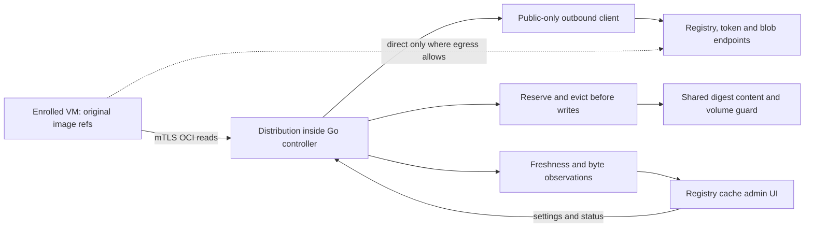

# Focused Validation Guide: embedded OCI image cache

**Future execution only**: No runtime test, AWS call or deployment was run while writing this plan. Use a few cohesive tests and journeys, not an exhaustive registry/toolchain matrix. [diagram.mmd](diagram.mmd) contains the editable conceptual flow.



## Setup and test discipline

Begin only during separately authorized implementation. Use existing Go/HTTP/database/guest fixtures, Jest and Playwright; one small `internal/imagecache/cache_test.go` suite covers core cache behavior, existing guest/workspace tests cover integration, and one admin component/E2E suite covers UI. Add tests first with behavior comments. No new test framework, benchmark harness or general fault-injection platform.

Use the approved CloudFormation development stack in `shiftbox-testing` (`888293065132`) in `us-east-2`. Follow the [repository instructions](../../AGENTS.md) to select the stack and apply reviewed change sets. Preserve existing profiles and workspaces, use labeled disposable fixtures, and keep deployment inputs, secrets and registry credentials local.

After implementation, run relevant focused Go suites, a race check on the cache coordinator, UI tests/typecheck/static build and embedded-assets test. Reuse existing canonical OpenAPI/type checks and migration tests. Broaden only for a real failure or changed integration. Examples:

```sh
go test ./internal/imagecache ./internal/guest ./internal/web ./internal/app ./tests/contract
go test -race ./internal/imagecache
npm --prefix ui run test -- --runTestsByPath features/admin/registry-cache.test.tsx
npm --prefix ui run typecheck
npm --prefix ui run build
CGO_ENABLED=0 go test -tags shiftbox_ui ./cmd/shiftbox -run '^TestEmbeddedBrowserAssets$' -count=1
```

## The focused checks

| Check | What to do and retain as evidence | Gates / UI rows |
| --- | --- | --- |
| **1. Protected pull and build** | Recheck/pin official Distribution API/advisories and actual linked notices. With guarded outbound client and bounded disposable cache, pull one anonymous public MCR fixture and launch its unchanged prebuilt/devcontainer Dockerfile cases. Record actual Docker image-store/embedded Buildx driver and controller requests, original ns/refs, platform/digest and repository file hashes. Confirm a second public registry works; no full cross-product matrix. Check tag revalidation and digest reuse using the same fixture. | G1/G2; UI-06 |
| **2. Trust and policy** | In the shared HTTP/DNS fixture, exercise normal anonymous token flow and representative private destination attempts at registry/redirect/token/blob/DNS paths; deny each actual dial. Existing enrolled guest succeeds, unknown/revoked fails; check renewal and one slow layer on the real guest path. Restricted guest pulls through the controller, with no-retention streaming under capacity refusal; controller outage never grants direct egress. Allowed-egress guest can use original upstream. No unsafe calls to real private services. | G3; UI-06/UI-08 |
| **3. Disk safety** | Through the UI set a small budget and 80/70 or smaller safe pressure thresholds on disposable storage. Pull shared content with two simultaneous requests; verify reserve/evict-before-write, count-once, active leases and partly cached reuse. One over-budget object uses no-retention streaming without temp writes. One interrupted pull/restart does not create a false warm hit. Use a bounded extra writer in the disposable area to check volume pressure; never exhaust installation/PostgreSQL storage. | G4; UI-03/UI-04/UI-07/UI-08 |
| **4. Outage and recovery** | Warm a complete fixture, interrupt upstream availability, launch and reload workspace details: exact amber text “The upstream registry could not be contacted. Using cached version.” persists while Running. Incomplete cache and upstream denial do not become stale success; TLS/security/rate-limit errors remain non-stale in unit cases. Restore upstream verification; warning clears and running digest stays correct, including when tag changed. | G5; UI-12 |
| **5. Admin UI** | One signed-in admin journey discovers the **Cache** tab, checks retained image references and their complete or partial status, saves enabled/path/budget/high-low, follows activation Stepper, reloads, checks usage/health/bytes/old-location/fallback, tries one invalid path, then moves to a valid disposable path after active pull drains. Active settings survive failure; new location starts empty, old files remain for reclamation. Include loading/empty/API error/retry/dirty conflict and keyboard checks in component tests. One separate view-only/member journey verifies controls plus direct API denial. Reuse these two journeys across all matrix rows. | G6; UI-01–UI-13 |
| **6. Release and small byte/timing comparison** | Use existing release/backup checks to inspect actual packaged licenses/notices, preserved ShiftBox MIT, cache payload exclusion, restart and safe guest/schema rollback compatibility. Follow the development rollout in `AGENTS.md` and verify ECS services report COMPLETED, the image digest and revision match, and the signed-in UI works. Compare one direct, one cold-cache and one warm-cache launch on **fresh VMs** with same architecture/image digest/repository. Reuse the prebuilt and Dockerfile fixture; confirm required launch paths without multiplying platform permutations. Record upstream payload versus local bytes and launch-to-actual-proxied-IDE time. | G7; UI-09; complete feature review |

For measurements, a fresh Docker/BuildKit store is essential: no preloaded Packer base or cached guest image/layers. Three fresh runs satisfy the at-least-two-fresh-workspaces requirement and permit direct/cold/warm comparison. Additional repeat runs are only needed if a confounder or inconsistent result prevents a useful conclusion. Controller warm content is retained between relevant runs. Metadata checks do not make warm image payload cold. Label guest-local/direct reuse and unknown quantities; don't infer speedup from bytes. Extraction/build/hooks remain separate costs.

The [UI matrix](contracts/admin-ui.md) defines every required setting/status and maps its API/persistence/permissions. The checks above can satisfy several rows at once; do not create independent E2E suites for every row. A complete feature needs real Go-backed save/reload/role proof and working production eviction, not just mocks or source inspection.

## Review evidence and cleanup

Write a short sanitized `specs/004-oci-pull-through-cache/validation-report.md` during execution with exact dependency/build versions, image/platform digests, the six check outcomes, UI-row/gate references, C/U/metadata/stream/direct/guest-local byte data or explicit unknowns, actual IDE timing, live review URL and ECS revision. No numerical performance promise is established by this plan.

Follow `AGENTS.md` for artifact builds, schema compatibility, CloudFormation change-set review, stability checks, CloudWatch troubleshooting and rollback. Afterward delete disposable VMs, profiles, test files, fixture tags and cloud resources. Reclaim retired managed test files after their leases end and preserve existing workspaces, profiles and operator backups.

Stage the linked controller notices from the actual Linux release binary using `scripts/stage-controller-licenses.sh`. The complete image packages them automatically. For fresh EC2 test workspaces, build a cache-capable private AMI and admit it through the [AWS development guide](../../platform/development/README.md#iterate-on-one-artifact-at-a-time). Use the [signed guest release procedure](../../platform/packer/README.md) when updating retained guests is in scope. Previous guests can still poll the controller with their existing protocol. After a schema upgrade, use the verified backup and reviewed recovery flow for any rollback to an older schema. Cache payloads stay outside application and identity checkpoints and can repopulate after recovery.
